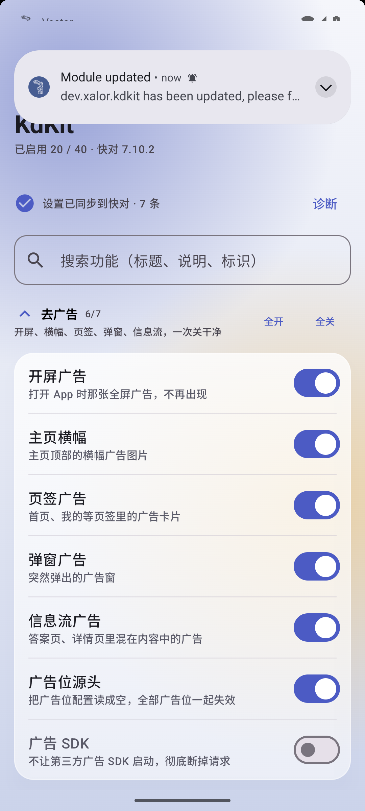
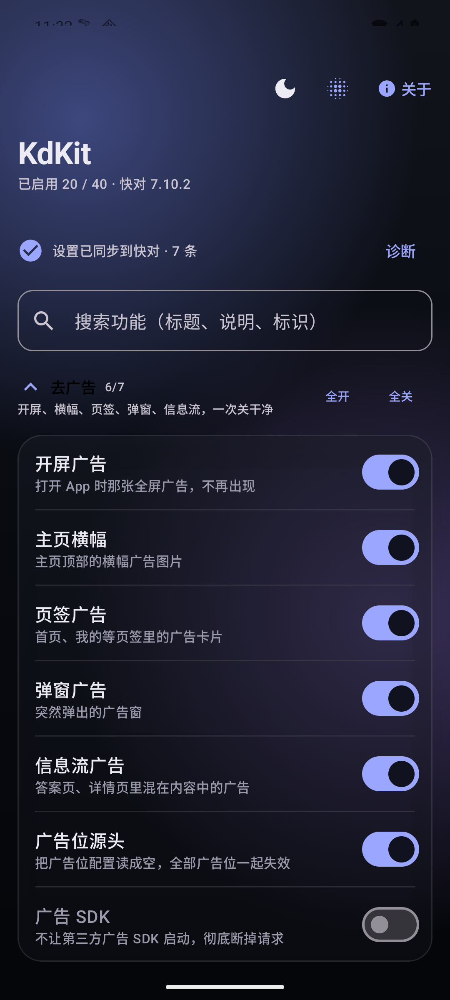
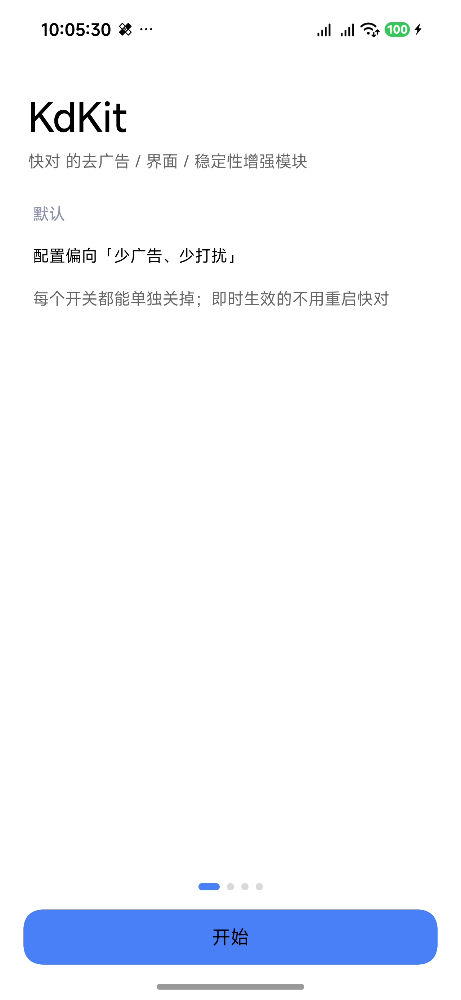
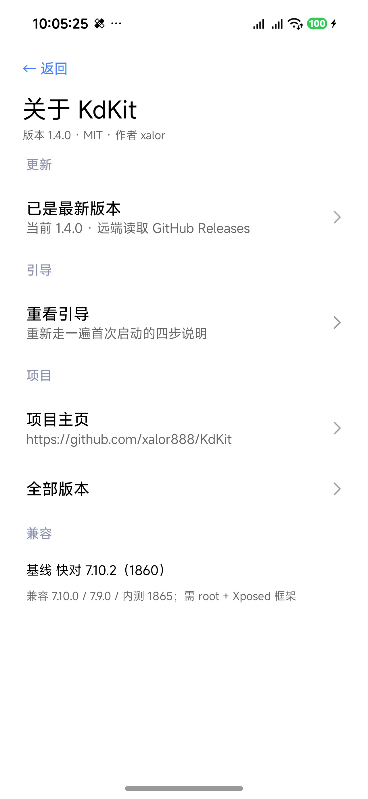

# KdKit

[](https://github.com/xalor888/KdKit/actions/workflows/ci.yml)
[](https://github.com/xalor888/KdKit/releases)
[](LICENSE)
[-3ddc84?logo=android&logoColor=white)](#兼容性)
[](https://kotlinlang.org)
[](https://developer.android.com/compose)

**快对（`com.kuaiduizuoye.scan`）的 Xposed / Vector 增强模块：去掉广告与会员推销，把界面统一成 Material 3 简约风。**

LSPosed / Vector 模块，40 个可热切换的功能，Material 3 设置页（浅色 / 深色 / 液态玻璃），
适配快对 **7.10.2 (1860)**，同时兼容 7.10.0 / 7.9.0 与内测构建 **6.21.11 (1865)**。

| 设置页（浅色） | 设置页（深色） |
|---|---|
|  |  |

| 首个启动引导 | 关于 / 检查更新（整页，不弹窗） |
|---|---|
|  |  |

## 安装

**方式一：自建仓库（无需审核，立即可用）**

在 LSPosed / Vector 的「模块仓库」里添加：

```
https://xalor888.github.io/KdKit/repo.json
```

之后就能在框架里直接看到版本与更新。这是**自建仓库**，不需要审核。

> 官方模块库（`modules.lsposed.org`，管理器默认列表里能搜到的那个）**需要审核**，
> 提交方式见 [`docs/lsposed-submission.md`](docs/lsposed-submission.md)。

**方式二：手动装 APK**

1. 从 [Releases](https://github.com/xalor888/KdKit/releases/latest) 下载 `KdKit-*.apk` 安装；
2. LSPosed / Vector 里启用 **KdKit**，作用域勾上 **快对（com.kuaiduizuoye.scan）**；
3. 强制停止快对，再打开。

## 功能

**41 个功能、39 个热开关**（改开关 1–2 秒生效，多数不用重启宿主）。完整清单与每项的钩点、
证据等级见 [`module/README.md`](module/README.md)，设置页把它们分成六组：

| 组 | 项数 | 内容 |
|---|---|---|
| 去广告 | 7 | 开屏 / 主页横幅 / 页签 / 弹窗 / 信息流 / 广告位源头 / 广告 SDK |
| 内容与会员 | 5 | 会员标识（仅客户端）、会员推广清理、去水印开关、大图水印、服务端弹窗 |
| 省心开关 | 3 | 跳过强制更新、跳过首次引导、退出守卫 |
| 答题助手 | 1 | 口算 / 诗词 / 成语 / 单词 PK 自动作答 |
| 界面外观 | 1 | Material 3 简约皮肤（含液态玻璃、深色窗口） |
| 诊断与抓取 | 23 | 签名 / 桥 / 路由 / 网络 / 家长模式等观测（默认收起） |

几个值得单独说的：

- **会员推广清理**（`rm_vip_promo`）：底部会员支付弹窗、开屏后的 `winVIPBottom` 弹窗、
  「我的」页那张 VIP 大卡、页面内的"立即开通"入口。**不改会员判定**，只去掉推销。
- **MD3 皮肤**（`md3_skin`）：H5 卡片半透明 + 背景模糊 + 高光描边，浅色下把品牌大色块归一；
  原生侧只动窗口级颜色（状态栏 / 导航栏 / 窗口底色）。深色只到窗口级 —— H5 页面自身没有深色主题，
  强行反色在真机上会读不清（原因写在 [`module/UI.md`](module/UI.md) §12）。

## 安装

1. 需要 **LSPosed**（或 Vector 等兼容框架）与 **Android 8.0+**。
2. 从 [Releases](https://github.com/xalor888/KdKit/releases) 下载 `KdKit-*.apk` 安装。
3. 在 LSPosed 里**启用模块**，作用域勾选 `com.kuaiduizuoye.scan`。
4. 打开 KdKit 设置页 → 「开启推荐配置」；然后完全结束并重开快对。

> 首次打开设置页若提示"设置没送到快对"，点「诊断 → 重新发布」修复权限即可
> （宿主与设置应用是不同 uid，配置文件必须 world-readable）。
>
> Release 附件由 CI 用 **debug 签名**构建（可直接安装，但签名不同于 Play 版）。

## 兼容性

| 快对版本 | versionCode | 状态 |
|---|---|---|
| **7.10.2** | 1860 | 主基线（按它校准 126 条钩子目标、99 条方法签名） |
| 7.10.0 | 1850 | 兼容（同一套混淆名） |
| 7.9.0 | 1840 | 兼容 |
| **6.21.11** | **1865** | 兼容（内测构建；混淆映射整体重排，用 `HostMap` 双名候选解析） |

模块启动时把宿主版本写进日志与抓取文件头部，版本漂移只警告、不阻止运行。

## 工程规模

| 项 | 数量 |
|---|---|
| 钩子目标 | 把 159 条钩子目标逐条对着 7.10.2 的解包树校验（159/159 解析成功） |
| 钩子签名（`check_hook_signatures`） | 99 条逐字节比对 |
| 工具链 | `kit/python/` 等 29 个模块；另有 132 个 python 工具 + 13 个 shell 脚本 |

## 构建

```bash
cd module
./gradlew assembleDebug        # 产物：module/app/build/outputs/apk/debug/app-debug.apk
./gradlew testDebugUnitTest    # JVM 单测（含设置页文案纪律）
```

CI（[`.github/workflows`](.github/workflows)）在每次 push 跑单测 + 构建，打 `v*` 标签时自动发 Release。

## 仓库结构

```
module/           KdKit 模块（Kotlin + Jetpack Compose + Xposed API）
  app/src/main/java/dev/xalor/kdkit/
    features/     41 个功能，每个一个 object，钩点写在同一文件里
    ui/           设置页（分组玻璃卡、搜索、批量开关、诊断/关于对话框）
    config/       配置通道（发布给宿主进程的 world-readable 文件）
    util/         Xp（钩子封装 + 台账）、抓取、限流…
kit/              配套逆向工具链（Python）：解析、签名复算、协议客户端、验收脚本
h5/               页面样本（离线分析用）
docs/             截图
（内部轮次日志与证据不随仓库分发：它们含目标 App 的真实接口响应与设备指纹）
```

## 免责声明

本项目仅用于**学习与研究** Android 应用的结构，以及 Xposed 模块的工程实践。
它**不改动服务端鉴权**，会员相关功能只影响客户端显示；请在你**自己拥有或获授权**的设备上使用，
并自行承担由此产生的一切后果。仓库不包含目标 App 的安装包（版权属原厂），
构建产物也不含其任何代码。

## License

[MIT](LICENSE) © 2026 xalor
